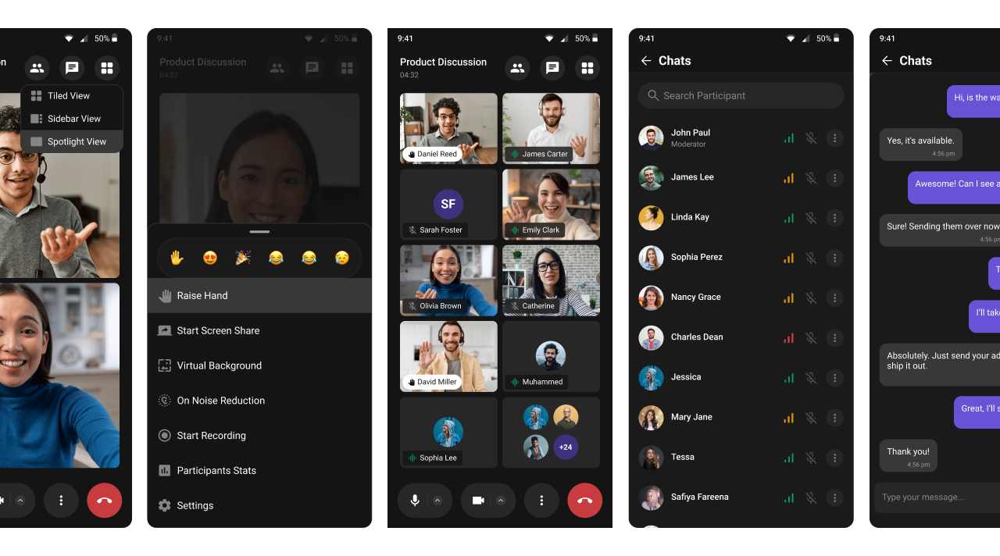

<p align="center">
  
</p>

# CometChat Flutter Calls SDK

The CometChat Calls SDK enables real-time voice and video calling capabilities in your Flutter application. Built on top of WebRTC, it provides a complete calling solution with built-in UI components and extensive customization options.

<p align="center">
  
</p>

---

## Getting Started

To set up the CometChat Calls SDK and utilize CometChat for your calling functionality, you'll need to follow these steps:

1. Registration: Go to the [CometChat Dashboard](https://app.cometchat.com/) and sign up for an account.
2. After registering, log into your CometChat account and create a new app. Once created, CometChat will generate an Auth Key and App ID for you. Keep these credentials secure as you'll need them later.
3. Check the [Key Concepts](https://www.cometchat.com/docs/fundamentals/key-concepts) to understand the basic components of CometChat.

## 📦 Installation

Add the dependency to your `pubspec.yaml`:

```yaml
dependencies:
  cometchat_calls_sdk: ^5.1.0
```

### Requirements

| Platform | Minimum |
|----------|---------|
| iOS      | 15.1, built with Swift Package Manager |
| Android  | API 26 (Android 8.0), `compileSdk` 36, Android Gradle Plugin 8.9.1 |

**iOS:** the plugin builds with Swift Package Manager only, since the native
Calls SDK 5.1 is not on the CocoaPods trunk. It is on by default from Flutter
3.44; on an older Flutter, or if your app turned it off, run
`flutter config --enable-swift-package-manager`.

**Android:** declare the plugin's ongoing call service in your app's
`AndroidManifest.xml`, inside `<application>`. Without it, Android stops the
microphone and camera when the app goes to the background:

```xml
<service
    android:name="com.cometchatcalls.cometchatcalls_plugin.services.OngoingCallService"
    android:exported="false"
    android:foregroundServiceType="microphone|camera" />
```

Upgrading from 5.0.x? See the [5.1.0 changelog](sdk/CHANGELOG.md) for the
breaking changes.

For the full setup guide, refer to our [official documentation](https://www.cometchat.com/docs/calls/flutter/overview).

## 🚀 Explore the Sample App

Dive straight into our sample app to see the CometChat Calls SDK in action.

- [Flutter Sample App](sample-apps/cometchat-calls-sample-app-flutter#readme)

---

## Help and Support

For issues running the project or integrating with our UI Kits, consult our [documentation](https://www.cometchat.com/docs) or create a [support ticket](https://help.cometchat.com/hc/en-us) or seek real-time support via the [CometChat Dashboard](https://app.cometchat.com/).
